<p align="center">
  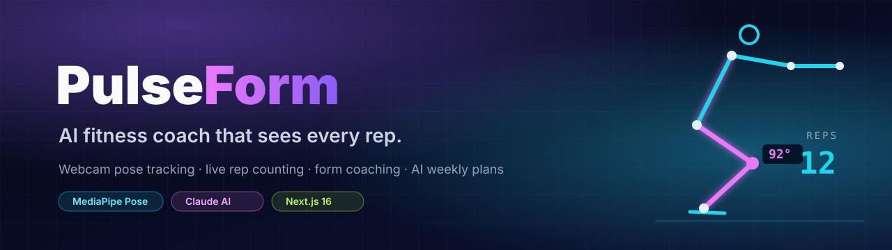
</p>

<p align="center">
  <a href="https://ai-fitness-coach-drab-six.vercel.app"></a>
  <br/><a href="https://ai-fitness-coach-drab-six.vercel.app">ai-fitness-coach-drab-six.vercel.app</a>
</p>

<p align="center">
  <a href="LICENSE"></a>
  
  
  
  
  
  <br/>
  
  
  
</p>

<h3 align="center">Your webcam becomes a personal trainer: it counts your reps, fixes your form in real time and plans your week with AI.</h3>

---

<p align="center">
  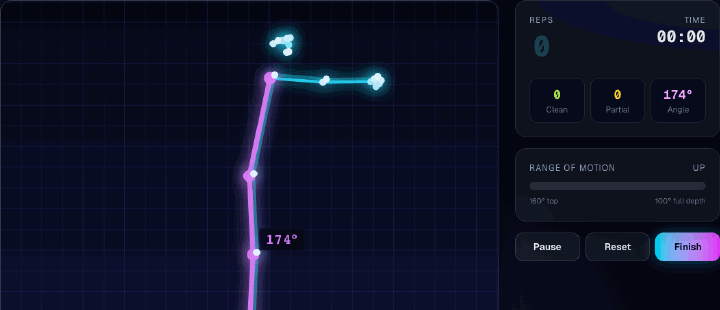
  <br/><sub>Demo mode: a synthetic athlete drives the real rep-counting pipeline. Rep 4 is too shallow (“Go lower”), and rep 5 leans too far forward (“Keep your chest up”).</sub>
</p>

## ✨ Features

| | |
|---|---|
| 🎯 **Honest rep counting** | Joint-angle state machines (`idle → up → down → bottom → up`) for **squats, push-ups and bicep curls**. Only full range-of-motion reps count. Half reps are tracked separately as *partial*. |
| 🧠 **Live form coaching** | Per-frame form checks with debouncing: *“Go lower”*, *“Keep your back straight”*, *“Keep your chest up”*, *“Keep your elbow tucked”*, *“Don't swing your body”*. |
| 🦴 **Neon skeleton overlay** | 33-point MediaPipe Pose Landmarker on the camera feed. The tracked joints glow, and the live joint angle is shown next to them. |
| 🔒 **Private by design** | Pose inference runs **in the browser** (WASM/WebGL). Video never leaves the device, and stats are stored in `localStorage`. |
| 🧪 **Demo mode** | No camera? A deterministic synthetic landmark generator (forward kinematics) feeds the *same* pipeline. It is used for tests, the landing-page hero and for people without a webcam. |
| ⏱️ **Sessions & stats** | Timer, pause/reset, clean vs. partial reps, range-of-motion gauge, estimated kcal and a form score. |
| 🔥 **Streaks & history** | Current/longest streak, 7-day activity chart, per-exercise totals and a history table. |
| 🤖 **AI weekly plan** | Claude (`claude-sonnet-5-5`) generates a 7-day plan from your goal, level, schedule and notes, using JSON structured outputs. Camera-trackable moves are tagged with **📷 TRACK** links. Without an API key it falls back to a rule-based generator. |
| 💳 **Free vs Pro** | Landing and pricing pages, a monthly/yearly toggle, Pro-gated history, form breakdown and AI plan limits. Checkout is simulated for the MVP. |

## 📸 Screenshots

| Landing | Live workout (demo mode) |
|---|---|
| 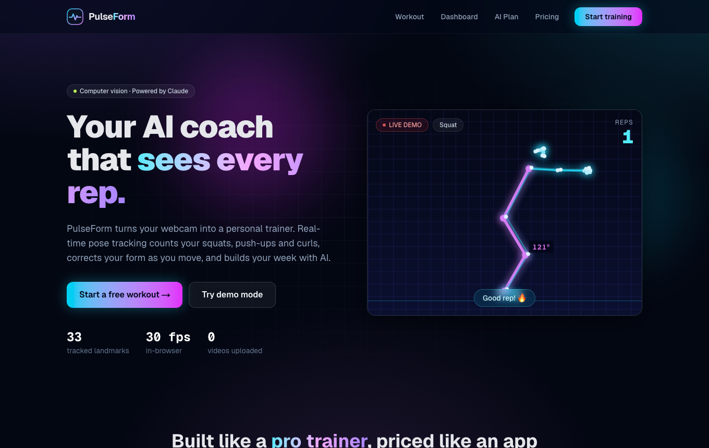 | 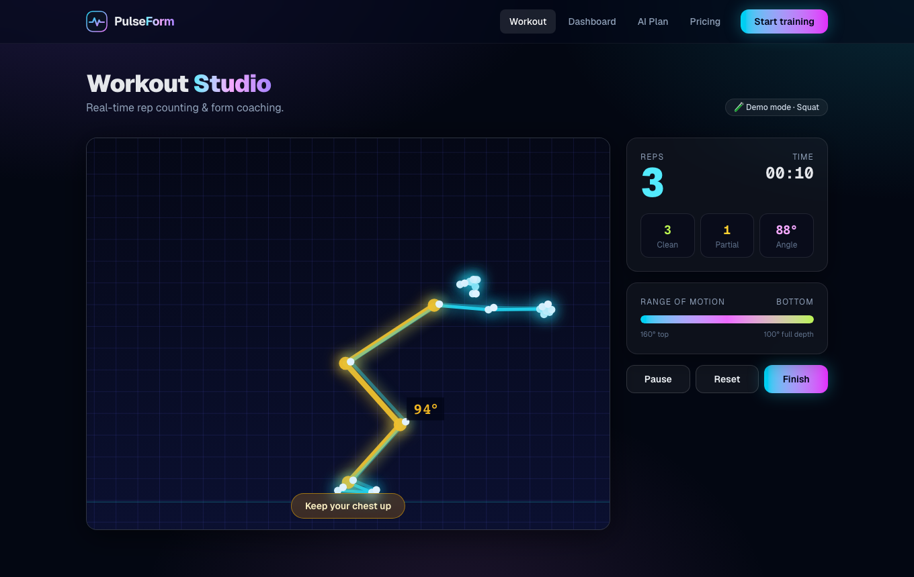 |
| **Session summary** | **Dashboard** |
| 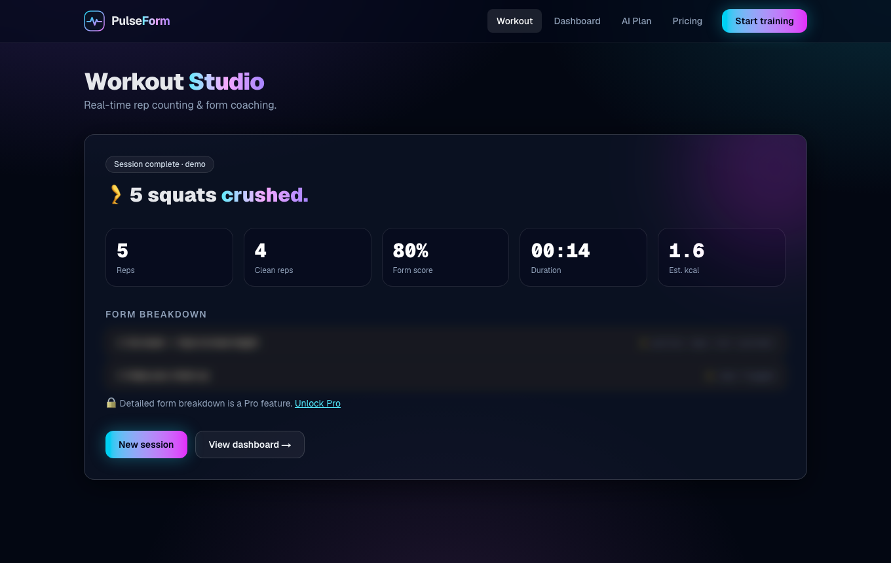 | 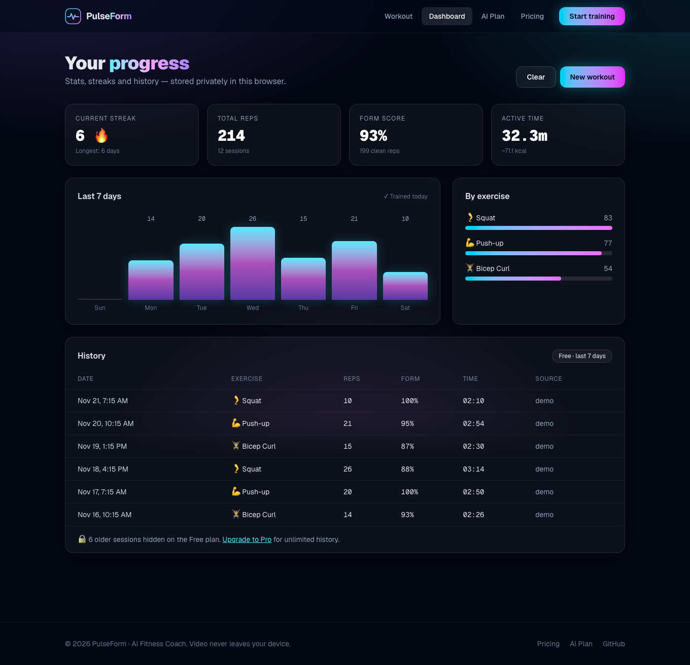 |
| **AI weekly plan** | **Pricing** |
| 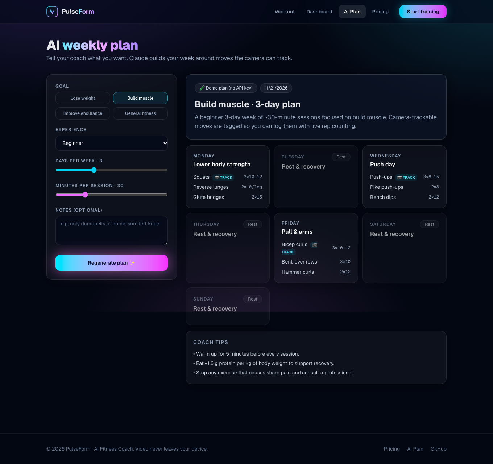 | 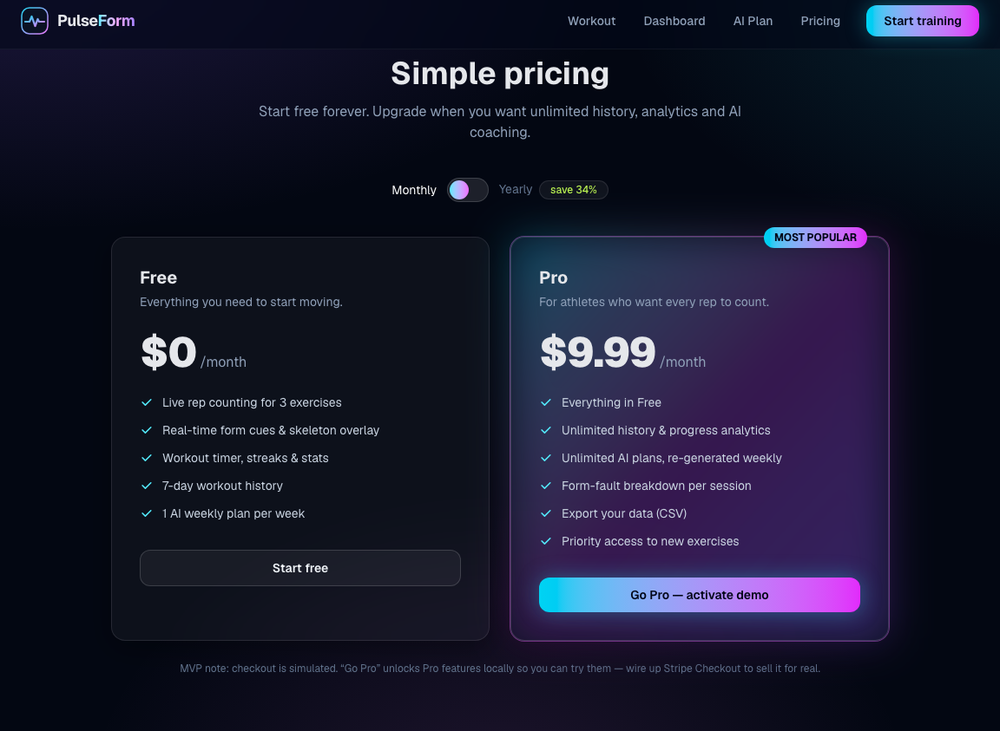 |

<p align="center">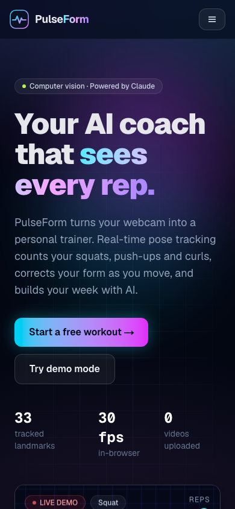 &nbsp; 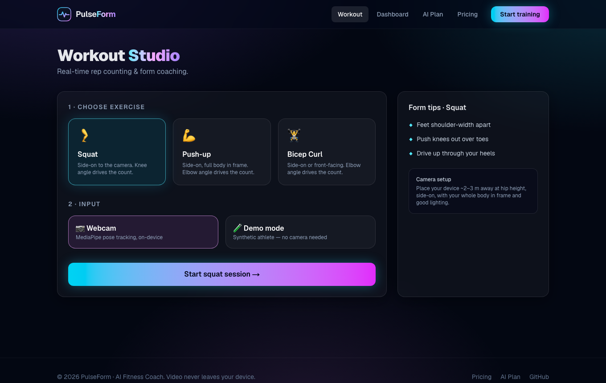</p>

## 🏗️ Architecture

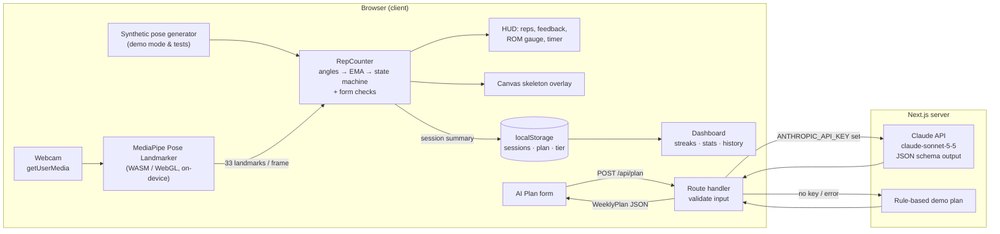

### How rep counting works

1. **Pick the visible side.** The counter uses whichever body side has higher landmark visibility for the exercise's joints.
2. **Compute the joint angle** (`atan2(|cross|, dot)`, numerically stable near 0° and 180°). Normalised x is first multiplied by the frame's aspect ratio, because MediaPipe squashes x.
   - Squat: hip–knee–ankle · Push-up / Curl: shoulder–elbow–wrist
3. **Smooth** the angle with an EMA (α = 0.6), then run the **state machine**:
   `up` (angle ≥ top threshold) → `down` (dropped by > 20°) → `bottom` (≤ depth threshold) → back to `up` = **1 rep**.
   Returning to `up` without reaching `bottom` = **partial rep** plus a depth cue. Reps faster than 0.4 s are rejected as jitter.
4. **Form checks** run only while the user is mid-rep and must persist for 3 frames. A faulty rep still counts, but it doesn't count as *clean*.

| Exercise | Angle | Top | Depth | Form checks |
|---|---|---|---|---|
| Squat | knee | 160° | 100° | torso lean > 50° → *Keep your chest up* |
| Push-up | elbow | 155° | 95° | shoulder–hip–ankle < 155° → *Keep your back straight*; must be in plank |
| Bicep curl | elbow | 150° | 55° | upper arm > 35° from torso → *Keep your elbow tucked*; torso sway > 18° → *Don't swing your body* |

## 🧰 Tech stack

- **Next.js 16** (App Router, Turbopack, Cache Components) · **React 19** · **TypeScript**
- **Tailwind CSS 4** for the dark neon/glassmorphism UI, with CSS keyframe animations and `prefers-reduced-motion` support
- **@mediapipe/tasks-vision** Pose Landmarker (lite model, GPU delegate with CPU fallback)
- **@anthropic-ai/sdk**: Claude `claude-sonnet-5-5` with JSON-schema structured output and server-side refusal fallback
- **Vitest** unit tests · **Playwright** e2e tests, screenshots and the demo GIF (encoded with `gifenc`, no ffmpeg needed)

## 🚀 Getting started

```bash
git clone https://github.com/BhargavKJani/ai-fitness-coach.git
cd ai-fitness-coach
npm install
cp .env.example .env.local   # optional: add ANTHROPIC_API_KEY for real AI plans
npm run dev                  # http://localhost:3000
```

No API key? The app runs fully in **demo mode**. Open `/workout?demo=1` to try it without a camera.

| Script | What it does |
|---|---|
| `npm run dev` | Dev server |
| `npm run build` / `npm start` | Production build / serve |
| `npm run lint` · `npm run typecheck` | ESLint · `tsc --noEmit` |
| `npm test` · `npm run test:coverage` | Vitest unit tests (angles, rep state machine, synthetic poses, stats/streaks, plan validation) |
| `npm run test:e2e` | Playwright e2e in demo mode (needs `npm run build` first; run `npx playwright install chromium` once) |
| `npm run docs:media` | Regenerate the README screenshots and `docs/demo.gif` |

**Camera tips:** stand side-on, 2–3 m from the camera, with your whole body in frame and good lighting. Camera access needs `https://` or `localhost`.

## 💰 Business model

PulseForm is a **freemium B2C subscription**. Inference runs on-device, so the marginal cost per user is close to zero. The only variable cost is the AI plan call, which is capped on the Free tier.

| | **Free** | **Pro: $9.99/mo or $79/yr** |
|---|---|---|
| Live rep counting & form cues | ✅ 3 exercises | ✅ + new exercises first |
| History | Last 7 days | Unlimited |
| AI weekly plans | 1 per week | Unlimited |
| Per-session form breakdown | 🔒 | ✅ |
| Data export | – | ✅ |

**Further revenue streams:**

- **B2B for coaches and gyms:** white-label PulseForm for remote clients, with a coach dashboard that shows clients' form scores (per-seat pricing).
- **Corporate wellness:** team step-and-rep challenges with streak leaderboards.
- **Programs marketplace:** paid 4–8-week programs from certified trainers, with a revenue share.
- **Physio and rehab:** range-of-motion tracking between appointments. A clinic plan is possible after regulatory review.

**Unit economics (illustrative):** one AI plan with Claude Sonnet 5.5 is about 1.5k input + 2k output tokens, roughly $0.02. At four plans a month, a Pro user costs about $0.10 in AI, which leaves a gross margin above 95% before payment fees.

## 🗺️ Roadmap

- [x] Pose tracking + rep counting for squats, push-ups and curls
- [x] Live form feedback, partial-rep detection and skeleton overlay
- [x] Demo mode with a synthetic athlete
- [x] Sessions, streaks, dashboard and history
- [x] AI weekly plan (Claude) with a mock fallback
- [x] Landing and pricing (Free vs Pro)
- [ ] Stripe Checkout + auth (Clerk/Auth.js) + cloud sync (Postgres)
- [ ] Voice coaching (Web Speech API) and rep-count audio cues
- [ ] More exercises: lunges, shoulder press, jumping jacks, plank hold timer
- [ ] Front-facing mode with 3D world landmarks for knee-valgus detection
- [ ] PWA / offline install, then native wrappers
- [ ] Coach and gym dashboard (B2B)

## 🧪 Testing

- **Unit (89 tests):** angle math edge cases (collinear, degenerate, translation/scale invariance), EMA smoothing, side picking, and the full rep state machine for every exercise. The state-machine tests cover clean reps, the phase order, partial reps, form faults, frame-rate robustness (15/30/60 fps), holding at the bottom with jitter, the minimum rep duration, the plank requirement and aspect-ratio correction. Also covered: streaks, totals, Free-tier history limits, plan request validation and the demo plan generator.
- **E2E (9 tests, demo mode, `ANTHROPIC_API_KEY` forced empty):** the landing page, the pricing toggle and Pro activation, a full squat workout (reps counted, feedback shown, session saved and visible on the dashboard), push-up and curl tracking, the camera-unavailable fallback, the sample-data dashboard, AI plan generation and API validation.

## ⚠️ Disclaimer

PulseForm gives general fitness guidance, not medical advice. Stop if anything hurts, and consult a professional about injuries or health conditions.

## 📄 License

[MIT](LICENSE) © 2026 Bhargav Jani
